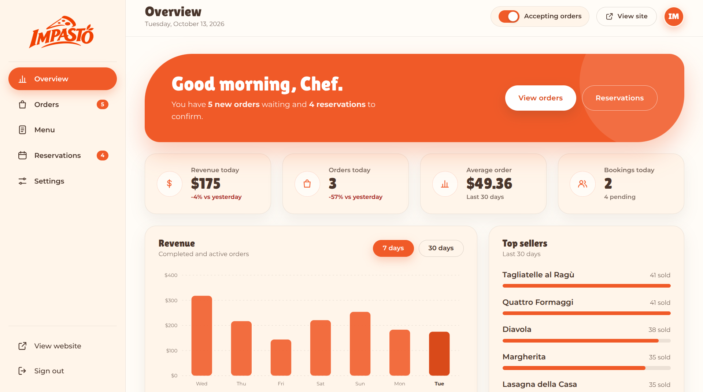

  

<h1 align="center">IMPASTO — Admin Dashboard</h1>

  <strong>Gestione del Ristorante. Semplificata.</strong>
   
  Una dashboard centralizzata per gestire le operazioni del ristorante, monitorare gli ordini, organizzare il menu e gestire le prenotazioni dei tavoli attraverso un'interfaccia intuitiva e dal design moderno.

---

## 🧡 About The Project

**IMPASTO Admin Dashboard** is a modern restaurant management interface designed to simplify daily operations through a clean, Italian-inspired design.

It brings essential tools for managing orders, menu items, table reservations, restaurant settings, and sales analytics into one centralized dashboard.

## 🌶 Features

- 📊 **Dashboard Overview** — Track revenue, orders, and restaurant performance.
- 🛍️ **Order Management** — View orders and update their statuses.
- 🍕 **Menu Management** — Manage menu items, categories, prices, and availability.
- 📅 **Reservation Management** — Review bookings and manage reservations.
- ⚙️ **Restaurant Settings** — Customize restaurant information and opening hours.
- 📈 **Sales Analytics** — Review revenue and sales performance.
- 🔎 **Search & Filtering** — Find orders, menu items, and reservations quickly.
- 🔐 **Admin Login** — Dedicated dashboard sign-in interface.
- 💾 **Local Storage** — Save changes directly in the browser.
- 📱 **Responsive Design** — Adapted for supported desktop and tablet screens.
- 🎨 **Modern UI/UX** — Warm colors, clean layouts, and consistent branding.
- 🖥️ **Website Integration** — Direct access to the main Impasto website.

## ⚙️ Tech Stack

- **HTML5**
- **CSS3**
- **JavaScript**
- **Local Storage API**
- **SVG Icons**
- **Google Fonts**
- **Responsive Web Design**

## 💾 Data Storage

The dashboard uses the browser's **Local Storage API** to persist menu items, orders, reservations, and restaurant settings.

- Changes are stored locally in the current browser.
- Data is not automatically synchronized across devices or browsers.
- The dashboard initializes with predefined demonstration data when no saved dataset is available.
- No backend database or server-side data synchronization is implemented in the supplied files.

The displayed orders, reservations, revenue figures, and customer information are sample data intended for demonstration purposes.

## ⚠️ Demo Notice

IMPASTO Admin Dashboard is a demonstration project created to showcase restaurant management interface design and client-side functionality.

All predefined orders, customer details, reservation records, contact information, financial figures, and other sample data are fictional or intended for testing purposes. The dashboard does not establish a connection to a live restaurant management system.

The current implementation uses client-side authentication and browser storage. It should not be used to manage real customer information, process actual orders, or store sensitive business data without appropriate backend infrastructure, secure authentication, access controls, and data protection measures.

## 🖥️ Website Preview

  

## 🔐 Demo Access

Use the following credentials to explore the demonstration dashboard:

- **Username:** `admin`
- **Password:** `impasto123`

These are demonstration credentials defined in the client-side application. This implementation does not provide production-grade authentication or server-side access control.

## 🌐 Live Websites

## </> Developer

**Developed by [Raed Mosaed](https://github.com/raedmosaed0)**

---

  © 2026 IMPASTO. All rights reserved.
  
